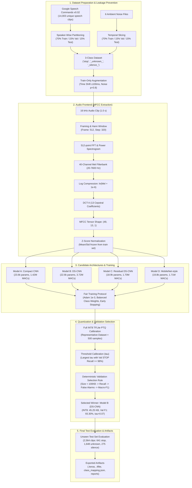

# TinyML Lab 4: "Shout STOP!" — Voice Emergency Stop Keyword Spotting

## Overview
This repository contains the implementation, benchmarking, and deployment optimization for **Lab 4** of the TinyML laboratory course.

The project designs, trains, optimizes, and evaluates a three-class offline keyword spotting (KWS) model (`stop`, `_unknown_`, `_silence_`) using the **Google Speech Commands v0.02** dataset. The target application is a hands-free, voice-activated emergency-stop safety system for resource-constrained edge hardware.

Rather than arbitrarily selecting a network topology, this experiment benchmarks **four distinct lightweight Convolutional Neural Network (CNN) architectures** under an identical training protocol:
1. **Model A:** Compact Standard CNN (`A_compact_cnn`)
2. **Model B:** Depthwise Separable CNN (`B_ds_cnn`)
3. **Model C:** Residual Depthwise Separable CNN (`C_res_ds_cnn`)
4. **Model D:** Compact MobileNet-style CNN (`D_mobilenet_style`)

Candidate models are converted into full **Float32** and **full-INT8** TensorFlow Lite (TFLite) flatbuffers. Model selection is governed by a strict, pre-declared **validation-only TinyML decision rule** (enforcing a $< 100\text{ KB}$ INT8 storage budget, high STOP recall, bounded false alarm rate, macro-F1, parameter efficiency, and latency). The held-out test set is evaluated strictly *after* the optimal architecture and decision threshold are frozen, guaranteeing zero test-set leakage.

> **Deployment scope note:** Edge inference latency and operator execution are **simulated using the TensorFlow Lite Interpreter on the host workstation CPU** (evaluating precomputed MFCC features). Physical deployment and hardware-in-the-loop validation on an embedded microcontroller (e.g., ARM Cortex-M with CMSIS-NN) were not performed in this laboratory study. See [Experimental Scope and Limitations](#experimental-scope-and-limitations).

---

## Lab Objectives
1. **Curate a 3-Class Speech Dataset:** Extract the target keyword `stop`, sample a representative background negative pool (`_unknown_`), and construct an acoustic `_silence_` class from disjoint background noise sources.
2. **Eliminate Data & Speaker Leakage:** Enforce an anonymized **speaker-wise split** (70% train / 15% validation / 15% test) and temporal slicing of noise files to prevent speaker and acoustic leakage across splits.
3. **Construct an Embedded Audio Frontend:** Implement a standard 16 kHz mono MFCC extraction pipeline (Hann windowing, STFT, 40-channel Mel filter bank, DCT-II) yielding `(49, 13, 1)` feature tensors, validated by a strict NumPy-to-TensorFlow parity check.
4. **Implement Four Distinct CNN Topologies:** Build four lightweight candidate architectures normalized to width multiplier $\alpha = 1.0$ (~19k to 23k parameters) to compare topological behavior rather than raw capacity.
5. **Execute a Fair Training Protocol:** Train all candidates under identical batching, class weighting, Adam optimization, learning rate reduction, and early stopping on validation loss.
6. **Apply Full INT8 Post-Training Quantization (PTQ):** Convert models to fully quantized INT8 flatbuffers using representative dataset calibration, ensuring an integer-only execution graph without float fallback.
7. **Optimize Operational Decision Threshold ($\tau$):** Calibrate the decision threshold on INT8 validation predictions to meet safety-critical recall constraints ($\ge 98.0\%$).
8. **Conduct Validation-Only Architecture Selection:** Execute a deterministic 5-step elimination rule to select the optimal production model based solely on validation evidence.
9. **Retrospective Test Benchmarking & Error Diagnosis:** Evaluate the winning model on the unseen test set, retrospectively benchmark all candidates, and diagnose false alarm and missed detection mechanisms.

---

## System Architecture & Workflow




---

## Dataset Description
The experiment utilizes the **Google Speech Commands v0.02** corpus (2.43 GB archive), filtered into a specialized 3-class classification problem:

- **Target Class (`stop`):** The emergency shutdown keyword. All available clean `stop` utterances are included.
- **Negative Class (`_unknown_`):** A representative background pool sampled at 10% across the remaining 34 command words in the dataset (`yes`, `no`, `up`, `down`, `left`, `right`, `on`, `off`, `go`, etc.).
- **Silence Class (`_silence_`):** Synthetic silence audio constructed from two sources:
  - 20% exact zero-amplitude waveforms (`zeros`).
  - 80% random 1-second crops from background noise recordings (`doing_the_dishes.wav`, `dude_miaowing.wav`, `exercise_bike.wav`, `pink_noise.wav`, `running_tap.wav`, `white_noise.wav`), scaled by a random gain $g \in [0.0, 1.0]$.

### Dataset Distribution Across Disjoint Splits
A total of **122 byte-identical duplicate recordings** were identified via MD5/SHA content hashing and removed prior to splitting.

| Split | Target (`stop`) | Negative (`_unknown_`) | Ambient (`_silence_`) | Total Clean Clips | Unique Speakers | Split Share (%) |
|---|---:|---:|---:|---:|---:|---:|
| **Train** | 2,573 | 7,059 | 1,156 | **10,788** | 1,636 | 68.8% |
| **Validation** | 569 | 1,513 | 250 | **2,332** | 351 | 14.9% |
| **Test** | 641 | 1,648 | 275 | **2,564** | 350 | 16.3% |
| **Total** | **3,783** | **10,220** | **1,681** | **15,684** | **2,337** | 100.0% |

*Note: In the training set, `_unknown_ : stop` imbalance is 2.74:1. Balanced class weights are computed and applied during training.*

---

## Audio Preprocessing
Standardized audio preparation is enforced across all splits and inference paths:
1. **Audio Format:** 16,000 Hz sample rate, single channel (mono).
2. **Amplitude Scaling:** 16-bit PCM integer scaling via $x_{\text{norm}} = \frac{x_{\text{int16}}}{32768.0} \in [-1.0, 1.0]$. No per-clip volume normalisation or pre-emphasis filters are applied.
3. **Clip Length:** Exactly 16,000 samples (1.0 s). Clips shorter than 1.0 s (9.5% of dataset) are right-padded with zeros.
4. **Training-Only Data Augmentation:** To boost acoustic robustness, clean training speech clips are augmented with one transformed copy ($+9,632$ augmented clips; total training pool = 20,420 clips):
   - **Time Shift:** Random temporal roll of $\pm 100\text{ ms}$ ($\pm 1,600$ samples).
   - **Background Noise Injection:** Probability $p = 0.8$, with noise gain sampled uniformly from $[0.0, 0.1]$. Noise is drawn exclusively from the training time-slice of background audio files.
   - *Validation and test sets are never augmented.*

---

## MFCC Feature Extraction
The acoustic frontend maps raw 1D audio waveforms into 2D time-frequency spectrogram representations:
- **Framing & Windowing:** Frame length of 512 samples ($32\text{ ms}$), hop length of 320 samples ($20\text{ ms}$), using a periodic Hann window:
  $$N_{\text{frames}} = 1 + \left\lfloor \frac{16000 - 512}{320} \right\rfloor = 49 \text{ frames}$$
- **Short-Time Fourier Transform (STFT):** 512-point real FFT yielding 257 positive frequency bins.
- **Power Spectrogram:** $|X(t, f)|^2$.
- **Mel Filter Bank:** 40 triangular Mel filters spanning 20 Hz to 7,600 Hz (HTK formula).
- **Logarithmic Compression:** $\ln(E_{\text{mel}} + 1\times 10^{-6})$.
- **Discrete Cosine Transform (DCT):** Orthogonal DCT-II scaled by $\frac{1}{\sqrt{2 \cdot N_{\text{mel}}}}$, retaining the first 13 cepstral coefficients.
- **Final Input Tensor:** $(49, 13, 1)$ representing 49 time frames $\times$ 13 MFCC coefficients $\times$ 1 channel.
- **Feature Normalisation:** Per-coefficient mean and standard deviation vectors are computed solely from the training set and frozen into model deployment constants.
- **NumPy Parity Verification:** A standalone NumPy re-implementation matching embedded C code was benchmarked against TensorFlow's native signal processing over 64 test clips. The maximum absolute difference was **$2.06 \times 10^{-4}$**, verifying mathematical parity.

---

## Dataset Splitting and Leakage Prevention
Preventing data leakage is paramount in speech recognition and keyword spotting:

1. **Speaker-Disjoint Splitting:**
   - Speech Commands filenames encode an anonymized speaker hash (e.g., `0a2b400e_nohash_3.wav`).
   - All 2,337 unique speakers are shuffled with fixed seed `SEED = 42` and split 70/15/15.
   - Every utterance from any given speaker resides exclusively in one split. This prevents the network from memorizing individual vocal tract resonances and pitch characteristics.
2. **Temporal Slicing of Background Noise:**
   - Background noise files (`doing_the_dishes.wav`, etc.) are long continuous recordings.
   - Slicing noise files randomly across splits would introduce identical acoustic signatures.
   - Each noise file is cut strictly by time: the first 70% is reserved for training, the next 15% for validation, and the final 15% for testing.
3. **Automated Leakage Verification:**
   The pipeline executes automated assert checks before model instantiation:
   - Shared speakers (Train-Val / Train-Test / Val-Test): **0**
   - Shared audio files: **0**
   - Shared MD5 audio hashes: **0**

---

## CNN Architectures
Four distinct topological paradigms were implemented and sized to ~20k parameters by setting width multiplier $\alpha = 1.0$:

| Architecture | Paradigm / Building Block | Layer Topology | Trainable Params | Total Params | Approx. MACs | Key Mechanism |
|---|---|---|---:|---:|---:|---|
| **Model A: Compact CNN** (`A_compact_cnn`) | Standard 2D Convolutions | 3× Conv2D (16, 32, 64 ch) + BatchNorm + ReLU, 2× MaxPooling2D (2×2), GAP, Dense(3) | 23,603 | 23,827 | 1,419,024 | Standard spatial convolutions with max pooling downsampling; baseline topology. |
| **Model B: DS-CNN** (`B_ds_cnn`) | Depthwise Separable Convolutions | $10 \times 4$ Conv2D stem (stride 2, 64 ch), 4× Depthwise Separable blocks ($3 \times 3$ DW + $1 \times 1$ PW, 64 ch), GAP, Dense(3) | 22,595 | 23,747 | 3,718,592 | Factorizes standard convolutions into spatial depthwise and cross-channel pointwise layers. |
| **Model C: Residual DS-CNN** (`C_res_ds_cnn`) | Residual Depthwise Separable | $3 \times 3$ Conv2D stem (32 ch), 4× DS Residual blocks (48 $\rightarrow$ 64 ch, stride-2 downsampling), GAP, Dense(3) | 18,947 | 20,067 | 1,702,288 | Additive residual connections around depthwise-separable blocks; strided $1 \times 1$ projection on downsampling. |
| **Model D: MobileNet-style** (`D_mobilenet_style`) | Inverted Bottleneck & Linear Residuals | $3 \times 3$ Conv2D stem (16 ch), 4× Inverted Bottleneck blocks ($1 \times 1$ expand $\rightarrow$ $3 \times 3$ DW $\rightarrow$ linear $1 \times 1$ project, ReLU6), $1 \times 1$ Head (64 ch), GAP, Dense(3) | 19,755 | 21,131 | 1,705,408 | MobileNetV2-style inverted bottleneck with expansion factor 2 and linear bottleneck projections. |

---

## Training Protocol and Model Selection

### Training Protocol
- **Optimizer:** Adam ($\text{learning rate} = 1 \times 10^{-3}$, $\beta_1 = 0.9, \beta_2 = 0.999$).
- **Loss:** Sparse Categorical Crossentropy.
- **Batch Size:** 64.
- **Max Epochs:** 30 epochs with warm-up run.
- **Regularization:** Balanced class weighting (`stop`: 1.323, `_unknown_`: 0.482, `_silence_`: 5.888).
- **Callbacks:**
  - `ReduceLROnPlateau`: factor 0.5, patience 3 epochs, monitored on `val_loss`.
  - `EarlyStopping`: patience 6 epochs, restoring best epoch weights.

### Decision Threshold ($\tau$) Optimization
In an emergency-stop system, missing a `stop` command is catastrophic, while false alarms cause costly process interruptions. A dedicated threshold $\tau$ governs classification:
$$\hat{y} = \begin{cases} \text{stop}, & \text{if } P(\text{stop}) \ge \tau \\ \arg\max_{c \in \{\text{\_unknown\_}, \text{\_silence\_}\}} P(c), & \text{otherwise} \end{cases}$$

$\tau$ is calibrated per candidate across a fine grid ($0.01 \le \tau \le 0.99$, step $0.01$) strictly using **INT8 validation predictions** to find the largest $\tau$ achieving $\text{Validation STOP Recall} \ge 98.0\%$:
- **Model A:** $\tau = 0.03$ (Val STOP Recall: 98.42%, FA Rate: 15.31%)
- **Model B:** $\tau = 0.07$ (Val STOP Recall: 98.07%, FA Rate: 9.08%)
- **Model C:** $\tau = 0.01$ [Fallback, highest achievable recall] (Val STOP Recall: 96.84%, FA Rate: 12.88%)
- **Model D:** $\tau = 0.03$ (Val STOP Recall: 98.07%, FA Rate: 11.00%)

### Deterministic 5-Step Model Selection Rule
Candidates were evaluated strictly on **validation data** using pre-declared tolerances:
1. **Step 0 (Feasibility):** Fully INT8 TFLite, zero float32 tensors, file size $< 100,000\text{ bytes}$. *(All 4 candidates passed).*
2. **Step 1 (STOP Recall):** Keep candidates with $\text{Recall} \ge \text{best} - 1.0\text{ pp}$ ($98.42\% - 1.0\% = 97.42\%$).
   - *Model C eliminated:* $96.84\% < 97.42\%$.
3. **Step 2 (False Alarm Rate):** Keep candidates with $\text{FA Rate} \le \text{lowest} + 1.0\text{ pp}$ ($9.08\% + 1.0\% = 10.08\%$).
   - *Model A eliminated:* $15.31\% > 10.08\%$.
   - *Model D eliminated:* $11.00\% > 10.08\%$.
4. **Step 3 (Macro-F1):** Keep candidates within $0.5\text{ pp}$ of top Macro-F1.
   - **Model B (`B_ds_cnn`) emerged as the sole survivor.**
5. **Step 4 (Tie-Break):** (Trainable parameters $\rightarrow$ median latency $\rightarrow$ name). Not needed.

**Selected Winner:** **Model B — DS-CNN (`B_ds_cnn`)**.

---

## Float32 and INT8 Quantization
Following selection, models were converted to TensorFlow Lite using full integer Post-Training Quantization (PTQ):
- **Calibration Dataset:** 500 clean representative speech samples from the training set.
- **Quantization Enforcements:** `inference_input_type = tf.int8`, `inference_output_type = tf.int8`, `supported_ops = [tf.lite.OpsSet.TFLITE_BUILTINS_INT8]`.
- **Interpreter Verification:**
  - Input Tensor: `int8`, shape `[1, 49, 13, 1]`, $\text{Scale} = 0.05389$, $\text{Zero Point} = -3$.
  - Output Tensor: `int8`, shape `[1, 3]`, $\text{Scale} = 0.00391$, $\text{Zero Point} = -128$.
  - Quantized Ops: 0 float32 fallback tensors, 0 Quantize/Dequantize operators in execution graph. Fully integer.

---

## TFLite Inference and Deployment Considerations
- **Host CPU Latency:** Single-threaded execution timed on Colab host CPU using the Python TFLite interpreter over 200 precomputed MFCC feature tensors (20 warm-up iterations, 5 timed passes).
- **Latency Observation:**
  - Model B Float32 median latency: **$0.096\text{ ms}$** ($0.109\text{ ms}$ mean).
  - Model B INT8 median latency: **$0.299\text{ ms}$** ($0.310\text{ ms}$ mean).
  - On x86 host CPUs, Float32 arithmetic benefits from hardware AVX vectorization, whereas Python TFLite INT8 inference executes scalar emulation routines. On edge microcontrollers (e.g., ARM Cortex-M4/M7/M33 with CMSIS-NN SIMD instructions), INT8 execution yields significant cycle-count acceleration and lower power dissipation.
- **Frontend Firmware Requirement:** The TFLite flatbuffers take normalized MFCC tensors as input. Microcontroller firmware must implement the audio sampling, Hann windowing, FFT, Mel weighting, DCT, and normalization constants specified in `class_mapping.json`.

---

## Evaluation Metrics
- **Accuracy (%):** Overall percentage of correct predictions across all three classes.
- **Macro-F1 (%):** Unweighted harmonic mean of F1 scores across classes, reflecting balanced performance.
- **STOP Recall (%):** Sensitivity for the target keyword: $\frac{\text{True STOP}}{\text{True STOP} + \text{Missed STOP}}$.
- **STOP Misses:** Absolute count of actual `stop` utterances misclassified as `_unknown_` or `_silence_`.
- **STOP False Alarms:** Absolute count of non-STOP utterances erroneously classified as `stop`.
- **False Alarm Rate (%):** Percentage of negative clips raising false alarms: $\frac{\text{False Alarms}}{\text{Total Non-STOP clips}}$.
- **Keras Agreement (%):** Percentage of identical predictions between the TFLite flatbuffer and the original Keras model.

---

## Experimental Results

### 1. Validation Comparison (Model Selection Evidence)
*Evaluated on 2,332 validation clips (569 stop, 1,513 unknown, 250 silence). All models evaluated as full INT8 TFLite under their respective $\tau$.*

| Metric | Model A (Compact CNN) | Model B (DS-CNN) [Winner] | Model C (Residual DS-CNN) | Model D (MobileNet-style) |
|---|---:|---:|---:|---:|
| **Trainable Params** | 23,603 | **22,595** | 18,947 | 19,755 |
| **Approx. MACs** | 1,419,024 | 3,718,592 | 1,702,288 | 1,705,408 |
| **Float32 Size (KB)** | 95.68 | 93.57 | 81.91 | 86.82 |
| **INT8 Size (KB)** | 30.35 | **45.25** | 44.08 | 50.62 |
| **Training Time (s)** | 37.5 | **31.7** | 46.8 | 53.1 |
| **Trained Epochs** | 19 (best: 13) | **9 (best: 3)** | 13 (best: 7) | 11 (best: 5) |
| **Best Val Loss** | 0.1259 | **0.0999** | 0.1313 | 0.1155 |
| **Optimal Threshold ($\tau$)** | 0.03 | **0.07** | 0.01 | 0.03 |
| **INT8 Val Accuracy (%)** | 87.99 | **92.54** | 89.41 | 91.17 |
| **INT8 Val Macro-F1 (%)** | 88.78 | **93.30** | 89.57 | 92.02 |
| **INT8 Val STOP Recall (%)** | 98.42 | **98.07** | 96.84 | 98.07 |
| **INT8 Val STOP Misses** | 9 | **11** | 18 | 11 |
| **INT8 Val False Alarms** | 270 | **160** | 227 | 194 |
| **INT8 Val FA Rate (%)** | 15.31 | **9.08** | 12.88 | 11.00 |
| **Median INT8 Latency (ms)** | 0.082 | 0.299 | 0.110 | 0.108 |
| **Selection Outcome** | Dropped Step 2 (High FA) | **SELECTED (Sole Survivor)** | Dropped Step 1 (Low Recall) | Dropped Step 2 (High FA) |

---

### 2. Final Test Set Evaluation of Selected Model B (`B_ds_cnn`)
*Evaluated on the held-out test set of 2,564 clips (641 stop, 1,648 unknown, 275 silence) under frozen threshold $\tau = 0.07$.*

| Evaluation Metric | Keras Checkpoint | Float32 TFLite | Full-INT8 TFLite | Quantization Delta (INT8 vs Float32) |
|---|---:|---:|---:|---:|
| **Model Storage Size** | 404.03 KB | 93.57 KB | **45.25 KB** | **-51.6% compression** |
| **Test Accuracy (%)** | 93.33 | 93.33 | **93.37** | **+0.04 pp** |
| **Macro-F1 (%)** | 92.56 | 92.56 | **92.59** | **+0.03 pp** |
| **STOP Recall (%)** | 98.44 | 98.44 | **98.44** | **+0.00 pp** |
| **STOP Misses (count)** | 10 | 10 | **10** | **0 change** |
| **STOP False Alarms (count)** | 161 | 161 | **160** | **-1 false alarm** |
| **STOP False Alarm Rate (%)** | 8.37 | 8.37 | **8.32** | **-0.05 pp** |
| **Keras Agreement (%)** | 100.00 | 100.00 | **99.73** | - |
| **Mean Latency (ms)** | - | 0.109 | **0.310** | +0.201 ms (host CPU) |
| **Median Latency (ms)** | - | 0.096 | **0.299** | +0.203 ms (host CPU) |

*Reference Uncalibrated Argmax Comparison:* When evaluated with standard $\arg\max$ (no $\tau$ thresholding), the INT8 model achieved 97.46% accuracy and 97.00% macro-F1, but STOP recall plummeted to **96.41%** (misses increased from 10 to **23**). This underscores why threshold tuning is non-negotiable in emergency stop applications.

---

### 3. Per-Class Test Performance (Selected Model B, Full INT8 TFLite)

| Class | Precision | Recall | F1-Score | Support (Clips) | Error Summary |
|---|---:|---:|---:|---:|---|
| **`stop`** | 0.7977 | 0.9844 | 0.8813 | 641 | 10 misses (all 10 predicted as `_unknown_`) |
| **`_unknown_`** | 0.9935 | 0.9217 | 0.9562 | 1,648 | 129 false alarms misclassified as `stop` |
| **`_silence_`** | 1.0000 | 0.8873 | 0.9403 | 275 | 31 false alarms (all from `doing_the_dishes.wav`) |
| **Macro Average** | **0.8637** | **0.9311** | **0.9259** | **2,564** | **Overall Test Macro-F1 = 92.59%** |

---

### 4. Retrospective Test Benchmark of All Candidates
*Scored on the test set with each candidate's frozen $\tau$. Provided solely for retrospective transparency; does not alter model selection.*

| Candidate Architecture | Frozen $\tau$ | Float32 Test Acc (%) | Float32 Macro-F1 (%) | INT8 Test Acc (%) | INT8 Macro-F1 (%) | INT8 STOP Recall (%) | INT8 STOP Misses | INT8 False Alarms | INT8 vs Keras Agreement (%) |
|---|---:|---:|---:|---:|---:|---:|---:|---:|---:|
| **Model A: Compact CNN** | 0.03 | 88.77 | 88.12 | 88.34 | 87.86 | **99.53** | **3** | 296 | 99.26 |
| **Model B: DS-CNN [Winner]** | 0.07 | **93.33** | **92.56** | **93.37** | **92.59** | 98.44 | 10 | **160** | **99.73** |
| **Model C: Residual DS-CNN** | 0.01 | 88.57 | 88.10 | 88.77 | 88.24 | 99.38 | 4 | 284 | 99.34 |
| **Model D: MobileNet-style** | 0.03 | 91.11 | 89.87 | 91.22 | 90.03 | 99.06 | 6 | 219 | 99.57 |

---

### 5. Detailed Error Analysis
- **Missed STOP Events (10 clips / 1.56% miss rate):**
  - All 10 missed `stop` utterances were classified as `_unknown_` (0 classified as `_silence_`).
  - Originates across 9 different speakers: speaker `5b09db89` accounted for 2 misses; 8 other speakers contributed 1 miss each (`3d86b69a`, `f250345e`, `0bde966a`, `7f208e83`, `98ea0818`, `40738a2d`, etc.).
  - Inspection indicates these clips feature rapid, clipped enunciation or heavy nasal resonance that suppresses lower formant energy.
- **STOP False Alarms (160 clips / 8.32% false alarm rate):**
  - 129 false alarms from speech words in `_unknown_`, and 31 from `_silence_`.
  - All 31 silence false alarms originated from a single background noise source: `noise:doing_the_dishes.wav`, caused by sharp ceramic acoustic transients mimicking stop plosives.
  - Top confusing spoken words: `up` (18 FAs / 26.9% word error), `seven` (16 FAs / 32.0%), `off` (12 FAs / 21.1%), `cat` (11 FAs / 31.4%), `dog` (9 FAs / 26.5%), `five` (8 FAs / 10.3%). These words share unvoiced plosive /t/ and /p/ burst spectra with the keyword `stop`.

---

## Key Observations
1. **DS-CNN Topology Dominance:** Depthwise Separable CNN (`B_ds_cnn`) achieved the best trade-off in accuracy, noise rejection, and convergence speed (trained in 9 epochs, 31.7 s). It delivered **93.37% test accuracy** and **92.59% macro-F1**, outperforming Model A (+5.03 pp) and Model C (+4.60 pp).
2. **Zero Quantization Degradation:** Full INT8 Post-Training Quantization introduced **no accuracy penalty** (Float32: 93.33% $\rightarrow$ INT8: 93.37%). STOP recall remained identical at **98.44%**, and prediction agreement between INT8 and Float32 reached **99.73%**.
3. **51.6% Memory Compression:** The INT8 TFLite model occupies **45.25 KB** (46,336 bytes), comfortably within microcontrollers possessing 64 KB or 128 KB SRAM/Flash constraints.
4. **Impact of Threshold Tuning:** Lowering $\tau$ from standard argmax (0.33) to **$\tau = 0.07$** reduced missed STOP detections by **56.5%** (from 23 down to 10 misses), ensuring high sensitivity for safety-critical deployment.

---

## Experimental Scope and Limitations
- **Simulated Execution Environment:** Inference benchmarks were performed on a host x86 CPU with the Python TFLite interpreter. They do not account for hardware constraints on bare-metal microcontrollers (e.g., cache misses, DMA transfer overhead, DSP instruction pipelines).
- **Frontend Overhead Excluded:** Latency numbers reflect only the neural network `invoke()` call on precomputed MFCC arrays. Real-world edge systems must allocate compute cycles for ADC sampling, STFT, and Mel filtering.
- **Single Training Run Variance:** Due to Colab GPU non-determinism, single-run metrics fluctuate within $\pm 1.0\text{ pp}$. The pre-declared selection tolerances explicitly mitigate run-to-run noise.
- **Acoustic Environment Scope:** The dataset consists of segmented 1-second clean spoken words. Performance in continuous speech or severe reverberant industrial environments requires keyword spotting streaming logic (sliding window with posterior smoothing).
- **Safety System Disclaimer:** This project is an academic prototype. It is **not certified under functional safety standards** (e.g., IEC 61508 / ISO 13849 SIL ratings) and must not be used as the sole safety mechanism in physical machinery.

---

## Repository Structure
```
.
├── 2548560_TINY_ML_LAB_5_STOP_KWS_1.ipynb           # Complete Jupyter Notebook with executable code and outputs
├── 2548560_Tejas R M_TinyML_LabManual.docx          # Academic laboratory manual and coursework report
├── TinyML Keyword Spotting Workflow.png             # End-to-end system architecture & pipeline diagram
├── vertopal.com_2548560_TINY_ML_LAB_5_STOP_KWS_1.pdf # PDF export of the complete laboratory notebook
├── lab5_stop_artifacts.zip                          # Bundled deployment models, CSV logs, and visual analytics
└── README.md                                        # Technical documentation and benchmarking report
```

### Exported Artifacts Archive (`lab5_stop_artifacts.zip`) Contents
The 1.38 MB artifact archive contains 25 standalone deliverables:
- **Trained Models:**
  - `selected_model.keras` (404.03 KB): Full-precision Keras model checkpoint.
  - `selected_model_float32.tflite` (93.57 KB): 32-bit floating-point TFLite flatbuffer.
  - `selected_model_int8.tflite` (45.25 KB): Fully quantized 8-bit integer TFLite flatbuffer.
- **Deployment & Mapping Configuration:**
  - `class_mapping.json`: JSON specification containing label mappings, audio frontend constants (sample rate, frame/hop size, Mel bounds), normalisation vectors, INT8 scale/zero-point parameters, and MCU input folding constants.
- **Comparative Metrics & Tables:**
  - `model_comparison_validation.csv`: Validation metrics across all 4 candidates.
  - `model_comparison_consolidated.csv`: Consolidated validation and retrospective test comparison table.
  - `model_comparison_per_class.csv`: Per-class precision, recall, and F1 across splits.
  - `model_comparison_test_retrospective.csv`: Retrospective test benchmarking table.
  - `selection_report.json`: Selection rule parameters, step-by-step elimination log, and outcomes.
  - `evaluation_results.json`: Full metrics, dataset stats, and leakage verification hashes.
- **Visual Analytics:**
  - `confusion_matrix.png` & `confusion_matrix_float32.png`: Test set confusion matrices.
  - `confusion_matrices_all_candidates_test.png`: Grid of confusion matrices across all 4 candidates.
  - `training_curves.png` & `training_curves_all_candidates.png`: Training loss/accuracy trajectories.
  - `comparison_val_accuracy_macro_f1.png`: Validation accuracy vs macro-F1 bar comparison.
  - `comparison_params_sizes.png`: Parameter counts vs INT8/Float32 model sizes.
  - `comparison_size_vs_stop_recall_val.png`: Storage footprint vs STOP recall trade-off.
  - `float_vs_int8.png`: Float32 vs INT8 parity and metric comparison.
  - `retrospective_test_comparison.png`: Four-model retrospective test metrics.
  - `waveform_stop.png`, `stft_spectrogram_stop.png`, `mfcc_stop.png`, `mfcc_unknown.png`, `mfcc_silence.png`: Acoustic waveform and feature representations.

---

## Requirements and Prerequisites
- **Python:** 3.8 to 3.11
- **Core Dependencies:**
  ```bash
  pip install tensorflow==2.21.0 keras==3.13.2 numpy pandas matplotlib scipy
  ```

---

## How to Run

### 1. Clone the Repository & Checkout Branch `Lab-4`
```bash
git clone https://github.com/Tejas2913/TinyML-Lab-2548560.git
cd TinyML-Lab-2548560
git checkout Lab-4
```

### 2. Verify Deliverable Files
Ensure all project deliverables are present:
```bash
ls -la
```

### 3. Run the Jupyter Notebook
Launch JupyterLab or Jupyter Notebook:
```bash
jupyter notebook 2548560_TINY_ML_LAB_5_STOP_KWS_1.ipynb
```
Execute cells sequentially to:
1. Download and extract Google Speech Commands v0.02.
2. Execute speaker-wise splitting and feature extraction.
3. Train all 4 candidate lightweight CNNs.
4. Run the validation selection rule and quantize Model B to INT8.
5. Generate confusion matrices and evaluate the test set.

### 4. Standalone INT8 TFLite Inference (Python Example)
```python
import numpy as np
import tensorflow as tf
import json
import zipfile

# Load class mapping from zip archive
with zipfile.ZipFile("lab5_stop_artifacts.zip", "r") as z:
    with z.open("class_mapping.json") as f:
        meta = json.load(f)
    int8_model_bytes = z.read("selected_model_int8.tflite")

# Initialize TFLite interpreter
interpreter = tf.lite.Interpreter(model_content=int8_model_bytes)
interpreter.allocate_tensors()

input_details = interpreter.get_input_details()
output_details = interpreter.get_output_details()

# Sample input tensor: (1, 49, 13, 1) normalized MFCC features
sample_mfcc = np.zeros((1, 49, 13, 1), dtype=np.float32)

# Quantize float MFCC input to int8 using model input scale and zero-point
scale, zero_point = input_details[0]['quantization']
int8_input = np.clip(np.round(sample_mfcc / scale) + zero_point, -128, 127).astype(np.int8)

interpreter.set_tensor(input_details[0]['index'], int8_input)
interpreter.invoke()

# Dequantize output probabilities
int8_output = interpreter.get_tensor(output_details[0]['index'])
out_scale, out_zero_point = output_details[0]['quantization']
probs = (int8_output.astype(np.float32) - out_zero_point) * out_scale

# Apply frozen safety threshold (tau = 0.07)
tau = 0.07
p_stop, p_unknown, p_silence = probs[0]
if p_stop >= tau:
    prediction = "stop"
else:
    prediction = "_unknown_" if p_unknown >= p_silence else "_silence_"

print(f"Probabilities -> stop: {p_stop:.3f}, unknown: {p_unknown:.3f}, silence: {p_silence:.3f}")
print(f"Decision: {prediction}")
```
